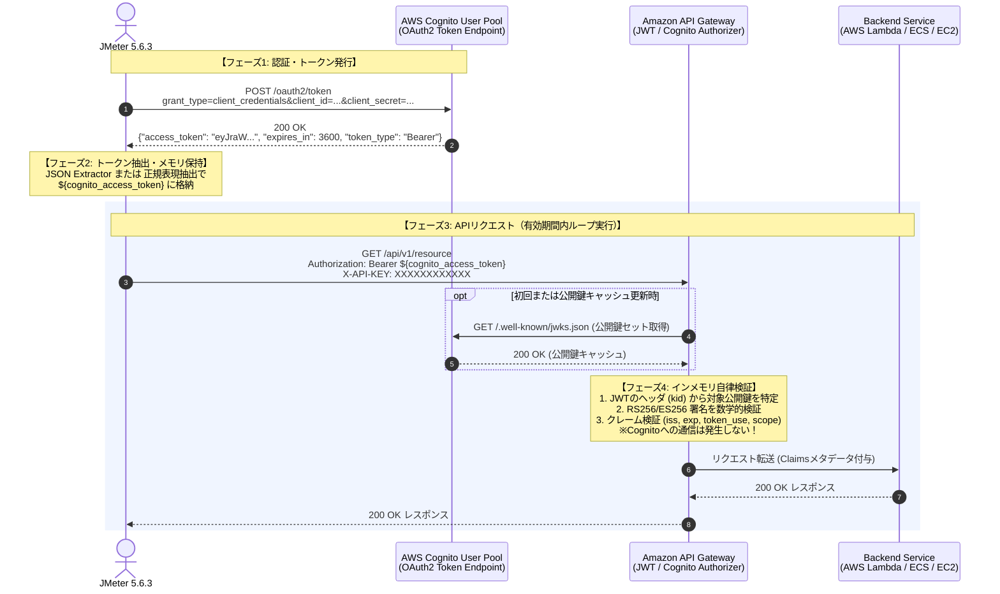

# JMeter × AWS Cognito × API Gateway 性能試験完全技術ガイド
## クライアントクレデンシャル・トークン再利用・OpenAPI自動化の極限詳解

---

## 1. はじめに・全体アーキテクチャ概要

現代のクラウドネイティブ・マイクロサービスアーキテクチャにおいて、**Amazon API Gateway** と **Amazon Cognito ユーザープール** による認証・認可基盤は業界標準として広く採用されています。
しかし、Apache JMeter による性能試験（負荷試験）を実施する際、認証トークン（JWT: JSON Web Token）の取得や取り回しを誤ると、以下のような致命的な問題が発生します。

1. **Cognito側のスロットリング（HTTP 429 Too Many Requests）により、APIの限界を測る前に試験が破綻する**
2. **都度トークン発行による無関係なレイテンシ（50〜200ms）が加算され、バックエンドAPI本来の性能特性が隠蔽される**
3. **既存のクライアントクレデンシャルを流用した結果、ステージングや本番の他サービスがクォータ枯渇で巻き添え停止する**

本ドキュメントでは、これらの問題を根本から解決し、最も正確かつ再現性の高い性能試験を実施するための設計指針、動作原理、JMeter 5.6.3 での実装パターン、そして OpenAPI 定義からの完全自動生成手法を徹底解説します。

---

## 2. 登場の歴史と背景・必要になった経緯

認証と認可の技術は、Webシステムのスケーラビリティの歴史そのものです。なぜ Cognito や JWT、Client Credentials が生まれ、性能試験でトークンの使い回しが必須となったのかを歴史的経緯から紐解きます。

```
【認証・認可の進化の歴史】

1990年代: Basic認証 / フォーム認証 + ステートフルセッション
  │      ・Cookie (JSESSIONID) とサーバー内メモリによるセッション管理
  │      ・課題: 水平スケール時にセッション共有DBやスティッキーセッションがボトルネック化
  ▼
2000年代: Web 2.0 / REST API / サービス間連携の爆発
  │      ・課題: パスワードアンチパターン（第三者サービスにユーザーの生パスワードを預ける危険）
  │      ・OAuth 1.0 (RFC 5849): 暗号署名（HMAC-SHA1）が複雑怪奇で実装難易度が高く普及阻害
  ▼
2012年: OAuth 2.0 (RFC 6749) & Bearer Token (RFC 6750) 策定
  │      ・TLS/HTTPS を前提とし、署名計算を撤廃して Bearer トークン方式を採用
  │      ・4つの標準グラント（認可コード、インプリシット、ROPC、クライアントクレデンシャル）の確立
  │      ・マシン間連携（M2M）専用フローとして「Client Credentials Grant」が定義される
  ▼
2014-2015年: OpenID Connect (OIDC) & JWT (RFC 7519) の標準化
  │      ・認可（OAuth2）にID認証（OIDC）を統合
  │      ・トークン自体に改ざん検知署名とメタデータを持たせる「自己完結型（Stateless）トークン: JWT」の完成
  ▼
現在: クラウドネイティブ・エッジ分散検証（AWS Cognito + API Gateway）
         ・認証サーバー（Cognito）に毎回問い合わせることなく、エッジ（API Gateway）が
           公開鍵（JWKS）を用いてインメモリかつマイクロ秒でJWTを自律検証
```

### 2.1 1990年代：Basic認証・ステートフルセッションの限界
インターネット黎明期、Webアプリケーションは単一のモノリシックサーバーで動作していました。
- **Basic認証**: リクエストごとに `Authorization: Basic base64(user:pass)` を送信。パスワードが都度ネットワークを流れ、ログや中間キャッシュへの漏洩リスクが極めて高い。
- **Cookie + セッション**: ログイン成功時にサーバーがメモリ上にセッションを保持し、ブラウザに Cookie（`JSESSIONID` 等）を発行。
- **限界**: サーバーを水平スケール（スケールアウト）させると、サーバー間でセッション情報を同期するRedis/Memcachedなどの共有ストアが必要になり、ここが性能試験における単一障害点（SPOF）かつ最大のボトルネックとなりました。また、ネイティブアプリや外部API連携にはCookie機構が適合しませんでした。

### 2.2 2000年代：API連携とパスワードアンチパターンの打破
2000年代後半、Twitter や Google などのオープンAPIが台頭しました。当時、外部サービスがユーザーのデータにアクセスするためには、**「外部アプリの入力フォームにユーザーのTwitterパスワードを入力させる」**という極めて危険な方法（パスワードアンチパターン）が横行していました。
これに対処するため **OAuth 1.0** が登場しましたが、リクエストごとに複雑なHMAC-SHA1署名文字列を組み立てる必要があり、クライアント・サーバー双方で計算負荷が高く、モバイル環境でのバグが多発しました。

### 2.3 2012年〜2015年：OAuth 2.0、Client Credentials、JWTの誕生
2012年に策定された **OAuth 2.0 (RFC 6749)** は、HTTPSによる通信路暗号化を前提とすることで署名生成の煩雑さを廃止し、シンプルにヘッダに添えて提示する **Bearer Token (RFC 6750)** を導入しました。
ここで、人間が介在しないサーバー間・システム間連携（Machine-to-Machine: M2M）のために正式化されたのが **Client Credentials Grant（クライアントクレデンシャルグラント）** です。

さらに2015年、**JWT (JSON Web Token: RFC 7519)** が登場しました。
従来のトークンはランダムな文字列（不透明トークン: Opaque Token）であり、APIサーバーがトークンの有効性を確認するには、**リクエストが届くたびに認証サーバーのデータベースへ「このトークンは有効か？」と問い合わせる（トークンイントロスペクション）**必要がありました。
JWTは、トークン自身の中にユーザーID、権限（スコープ）、有効期限、そして発行元のデジタル署名を内包することで、**「認証サーバーに問い合わせることなく、受け取った側が単独で正当性を検証できる」**というステートレスな革命をもたらしました。

---

## 3. 小学生にもわかる超明快な解説（遊園地のたとえ話）

技術用語が多くて難しく感じる仕組みも、**「テーマパーク（遊園地）」**に置き換えると一発で理解できます！

```
+--------------------------------------------------------------------------+
|                        テーマパークのたとえ話                              |
+--------------------------------------------------------------------------+
|  【登場人物】                                                             |
|  ・検査員ロボット      ＝ JMeter（乗り物が壊れないかテストするロボ）         |
|  ・正面ゲートの受付窓口 ＝ Cognito（チケットを発行する大元）                 |
|  ・社員証と秘密の暗証番号 ＝ クライアントクレデンシャル（IDとパスワード）     |
|  ・魔法のリストバンド   ＝ アクセストークン（有効期限スタンプ入りの腕輪）     |
|  ・アトラクションの門番 ＝ API Gateway（乗り物の入口にいる係員）            |
|  ・ジェットコースター   ＝ バックエンドAPI（テストしたい実際の乗り物）       |
+--------------------------------------------------------------------------+
```

### どうして毎回受付窓口に行ってはいけないの？
- **悪いやり方（都度取得）**：
  検査員ロボット（JMeter）が、ジェットコースターに1回乗るたびに、**「毎回正面ゲートの受付窓口まで全力疾走で戻って、社員証を見せて新しいリストバンドをもらい直す」**。
  - **何が起きる？**
    受付窓口（Cognito）の前に大行列ができて、受付のお姉さんが「もう無理！多すぎます！（429 Too Many Requests）」とパンクしてしまいます。
    しかも、検査員ロボットは走っている時間ばかりかかって、本当に調べたい「ジェットコースターの速さ（APIの性能）」が全く測れません！
- **正しいやり方（リストバンドの使い回し）**：
  最初に正面ゲートで「今日1日有効なリストバンド」を1本もらいます。
  ジェットコースターの門番（API Gateway）は、リストバンドに押された王様の魔法の印鑑（デジタル署名）を見るだけで、**「よし、本物だな！期限も切れてないから通ってよし！」**と0.001秒で通してくれます。門番は受付窓口に電話をかけたりしません。
  だから、リストバンドの有効期限が切れるまでは、そのリストバンドを腕につけたまま何回も連続でジェットコースターに乗ってテストするのが一番賢いのです！

---

## 4. 動作原理と動作イメージ（アーキテクチャ深掘り）

AWS Cognito と API Gateway が連携する際の内部的な動作原理と、暗号数学的な署名検証メカニズムを解説します。

### 4.1 全体シーケンス図



### 4.2 Cognito アクセストークン（JWT）の構造詳解
Cognito が発行するアクセストークンは、ピリオド（`.`）で区切られた3つの Base64URL 文字列で構成されます。

```
eyJraWQiOiJleGFtcGxlS2lkMTIz... (Header)
.
eyJzdWIiOiIxMmFiY2Qt... (Payload)
.
TJVA95OrM7E2cBab30RMHrHDcEfxjoYZgeFONFh7HgQ (Signature)
```

1. **Header（ヘッダー）**:
   ```json
   {
     "alg": "RS256",
     "kid": "d1a2b3c4d5e6f7g8h9i0...",
     "typ": "JWT"
   }
   ```
   - `alg`: 暗号アルゴリズム（RSA Signature with SHA-256）。
   - `kid`: Key ID（鍵識別子）。Cognito User Pool が持つ複数の公開鍵のうち、どの鍵で署名されたかを示します。
2. **Payload（ペイロード / クレーム）**:
   ```json
   {
     "sub": "2a1b3c4d-5e6f-7a8b-9c0d-1e2f3a4b5c6d",
     "token_use": "access",
     "scope": "myapi/read myapi/write",
     "auth_time": 1727750000,
     "iss": "https://cognito-idp.ap-northeast-1.amazonaws.com/ap-northeast-1_xxxxxxxxx",
     "exp": 1727753600,
     "iat": 1727750000,
     "version": 2,
     "jti": "b5e9f8a1-3c2d-4e5f-a6b7-c8d9e0f1a2b3",
     "client_id": "7xxxxxxxxxxxxxxxxxxxxxxxxx"
   }
   ```
   - `token_use`: `access` であること（Cognito の ID トークンは `id` となり、アクセストークンとは厳密に区別されます）。
   - `exp`: 有効期限の UNIX タイムスタンプ（デフォルトは発行から 3600 秒 = 1 時間）。
   - `iss`: 発行者 URL（対象の Cognito ユーザープールエンドポイント）。
3. **Signature（デジタル署名）**:
   - Cognito の**秘密鍵（Private Key）**で `SHA256(Base64URL(Header) + "." + Base64URL(Payload))` を暗号化したもの。

### 4.3 API Gateway におけるゼロ通信・自律検証の数学的原理
API Gateway は、リクエストを受信した際に Cognito にネットワークアクセスすることなく、以下の手順でインメモリ検証します。
1. **JWKS（公開鍵セット）のキャッシュ取得**:
   API Gateway は起動時または初回検証時に `https://cognito-idp.{region}.amazonaws.com/{userPoolId}/.well-known/jwks.json` を取得し、メモリにキャッシュします。
2. **公開鍵による復号照合**:
   リクエストの JWT ヘッダにある `kid` と一致する公開鍵を取り出し、デジタル署名を復号します。復号結果が `Header + "." + Payload` の SHA-256 ハッシュ値と完全に一致すれば、**「1ビットの改ざんもなく、間違いなく Cognito が発行したトークンである」**ことが数学的に証明されます。
3. **クレーム判定**:
   現在の時刻が `exp` 未満であるか、`iss` が指定のユーザープールであるか、必要な `scope` が含まれているかをチェックします。
   この処理はすべて CPU のメモリ上でマイクロ秒（0.1ms未満）で完了するため、秒間数万リクエストのエッジトラフィックをさばくことが可能です。

---

## 5. クライアントクレデンシャルの選択：専用登録 vs 既存流用

性能試験を実施するにあたり、最も議論される論点の一つが**「性能試験専用のクライアントクレデンシャルを登録すべきか、既存のアプリ用クライアントをJMeter用に調整すべきか」**です。

結論から申し上げますと、**「性能試験専用の App Client（クライアントクレデンシャル）を新規登録して利用する」ことが、AWSのベストプラクティスおよびセキュリティ・運用設計の観点から圧倒的に推奨されます。**

### 5.1 比較マトリクス

| 評価項目 | 性能試験専用クライアントクレデンシャル（推奨） | 既存クライアントクレデンシャルの流用・調整（非推奨・危険） | 理由・影響 |
| :--- | :--- | :--- | :--- |
| **API スロットリングの隔離** | **完全に隔離される** | **共連れで本番/検証環境が停止する** | CognitoのApp Client単位またはトークンエンドポイント全体でのレート制限超過時、既存サービスの正規トラフィックが拒否されるリスクを排除可能。 |
| **セキュリティ・秘密鍵管理** | **試験担当者のみに最小権限で配布** | **既存の重要シークレットが漏洩するリスク** | JMeterのシナリオファイル（JMX）やリポジトリにクレデンシャルが誤混入した際、既存システムの侵害を防ぐ。 |
| **監査証跡（CloudTrail）** | **試験トラフィックを100%識別可能** | **通常トラフィックと試験トラフィックが混濁** | AWS CloudTrail において `clientId` でフィルタリングすることで、性能試験による負荷と通常業務アクセスを完全に切り分けて分析可能。 |
| **トークン有効期間の個別設定** | **試験特性に合わせて最適化可能** | **既存システムのセキュリティ要件に縛られる** | 長時間耐久試験用に有効期間を伸ばしたり、逆にリフレッシュ検証のために短縮するなどの調整を既存環境に影響を与えず実施可能。 |
| **OAuth スコープの最小権限** | **試験対象APIのスコープのみに限定** | **余計な広範スコープが付与されるリスク** | 試験対象外の重要リソース（決済API、ユーザー削除API等）へのアクセス権限を排除できる。 |
| **試験後のクリーンアップ** | **App Client を即時削除・無効化可能** | **設定を元に戻す作業で設定ミス・先祖返りリスク** | 試験終了後に不要なアクセス元をボタン一つで完全消滅させられる。 |

### 5.2 既存クレデンシャル流用の唯一の例外シナリオ
既存のクライアントクレデンシャルをそのまま使うべき唯一のケースは、「本番と1ビットも違わない完全同一のApp Client設定における、Cognito側のクォータ消費特性そのものを監査・検証したい場合」に限られます。しかしその場合でも、本番環境ではなく独立した検証用AWSアカウント（Stage/Perf環境）で実施するのが大原則です。

---

## 6. トークン取得タイミング：都度取得 vs 有効期間内の使い回し（キャッシュ）

### 6.1 都度取得が「絶対悪（アンチパターン）」である理由
APIリクエストを1回投げるたびに Cognito の `/oauth2/token` を呼び出す構成は、性能試験において以下の破綻を招きます。

1. **Cognito User Pool のレート制限（スロットリング）に衝突**:
   Cognito ユーザープールのトークンエンドポイントには、AWSアカウント・リージョンごとに厳格なソフトリミット（例: 500〜1,500 RPS）が設定されています。ターゲットの API Gateway / バックエンドが 10,000 RPS に耐えられるかテストしたいのに、手前の Cognito が 1,000 RPS で 429 エラーを返し、試験が中断します。
2. **測定対象の歪曲（性能のすり替え）**:
   都度取得を行うと、JMeterの測定レスポンスタイムの大部分が「Cognito の認証処理時間（TLSハンドシェイク＋RSA鍵生成計算＋ネットワーク遅延：約50〜200ms）」で占められます。テスト対象であるバックエンドシステムのボトルネックが完全に覆い隠されてしまいます。
3. **コストの浪費**:
   Cognito のリクエスト数課金や NAT Gateway の転送通信費が無駄に跳ね上がります。
4. **現実世界の挙動との著しい乖離**:
   実際のマイクロサービスやWeb/スマホアプリは、一度取得したアクセストークンをメモリやストレージにキャッシュし、有効期限（例: 3600秒）が近づくまで再利用します。都度取得は非現実的なトラフィックモデルです。

### 6.2 トークン再利用の正当性
トークンを有効期間内（例: 3600秒の90%である3240秒間など）キャッシュして使い回すことで：
- **API Gateway およびバックエンドAPIに対して純粋な負荷（100%の負荷）を印加できる**
- **Cognito のスロットリングに一切抵触しない**
- **実運用環境と全く同一のトラフィックパターンを正確にシミュレートできる**

---

## 7. JMeterでのトークン抽出方法（JSON Extractor vs 正規表現抽出）

Cognito の `/oauth2/token` レスポンス（JSON）から `access_token` を取り出す際、JMeter には **JSON Extractor（JSON抽出）** と **Regular Expression Extractor（正規表現抽出）** の2つの選択肢があります。

### 7.1 両者の比較

| 項目 | JSON Extractor（推奨） | Regular Expression Extractor（歴史的/軽量） |
| :--- | :--- | :--- |
| **構文** | `$.access_token` | `"access_token"\s*:\s*"([^"]+)"` |
| **耐障害性** | **極めて高い**（キーの順序、改行、スペースの変動に完全耐性） | **中程度**（空白や改行の想定外パターンでマッチ失敗リスク） |
| **可読性・保守性** | **直感的で標準的** | 正規表現のエスケープ等で可読性が低い |
| **CPU負荷** | わずかにJSONパースのオーバーヘッドあり | 正規表現エンジンのネイティブマッチで極めて微小 |
| **適用推奨** | **JMeter 5.x 時代のデファクトスタンダード** | 単純な単一値抽出で極限のCPU節約が必要な場合 |

### 7.2 具体的な設定値

#### 【設定例A】JSON Extractor（JSON抽出）
- **名前**: `JSON Extractor - access_token`
- **Names of created variables**: `cognito_access_token`
- **JSON Path expressions**: `$.access_token`
- **Match No. (0 for Random)**: `1`
- **Default Values**: `TOKEN_NOT_FOUND`

#### 【設定例B】Regular Expression Extractor（正規表現抽出）
- **名前**: `RegEx Extractor - access_token`
- **Names of created variables**: `cognito_access_token`
- **Regular Expression**: `"access_token"\s*:\s*"([^"]+)"`
- **Template**: `$1$`
- **Match No. (0 for Random)**: `1`
- **Default Value**: `TOKEN_NOT_FOUND`

---

## 8. JMeterでのトークン使い回し実装パターン（全4手法）

JMeterでトークンを取得し、有効期間内に使い回すための具体的な4つの実装パターンを提示します。

---

### パターン1：【最高峰】JSR223 + If Controller による動的有効期限判定（長時間耐久試験推奨）

アクセストークンの有効期限（`expires_in`）を取得し、現在時刻と比較して**「期限切れまたはトークン未取得の場合のみ Cognito を呼び出し、有効期間内はキャッシュを使い回す」**最も堅牢な実装です。

#### シナリオツリー構造
```text
Test Plan
 └ Thread Group (スレッド数: N, ループ回数: 無限 または 多数)
     ├ JSR223 PreProcessor (トークン有効期限判定スクリプト)
     ├ If Controller (条件: ${__groovy(vars.get("NEED_TOKEN") == "true")} )
     │   ├ HTTP Request: Cognito Token Acquisition (POST /oauth2/token)
     │   │   ├ JSON Extractor (access_token -> cognito_access_token)
     │   │   └ JSON Extractor (expires_in -> cognito_expires_in)
     │   └ JSR223 PostProcessor (有効期限タイムスタンプ計算・保存)
     ├ HTTP Header Manager
     │   ├ Authorization: Bearer ${cognito_access_token}
     │   └ X-API-KEY: ${api_key}
     └ HTTP Request: Target API Gateway Call (GET/POST /api/v1/...)
```

#### スクリプト実装コード

**1. JSR223 PreProcessor (判定処理)**
```groovy
long currentTime = System.currentTimeMillis();
String token = vars.get("cognito_access_token");
String expiryStr = vars.get("token_expiry_timestamp");

if (token == null || token.isEmpty() || expiryStr == null) {
    // トークン未取得
    vars.put("NEED_TOKEN", "true");
} else {
    long expiryTime = Long.parseLong(expiryStr);
    // 有効期限の60秒前に安全マージンを取ってリフレッシュ
    if (currentTime >= (expiryTime - 60000)) {
        vars.put("NEED_TOKEN", "true");
    } else {
        vars.put("NEED_TOKEN", "false");
    }
}
```

**2. JSR223 PostProcessor (トークン取得直後の有効期限計算)**
```groovy
long currentTime = System.currentTimeMillis();
String expiresInStr = vars.get("cognito_expires_in"); // 例: "3600"
long expiresInSeconds = (expiresInStr != null) ? Long.parseLong(expiresInStr) : 3600L;

// 有効期限タイムスタンプを計算（ミリ秒）
long expiryTimestamp = currentTime + (expiresInSeconds * 1000L);
vars.put("token_expiry_timestamp", String.valueOf(expiryTimestamp));
vars.put("NEED_TOKEN", "false");
log.info("Cognito Token acquired successfully. Expires at: " + new Date(expiryTimestamp));
```

---

### パターン2：`setUp Thread Group` + プロパティ共有（M2M・全スレッド単一トークン共有）

マシン間連携（Client Credentials）では、全スレッドが同一のクライアント資格情報を使用するため、**「試験開始前に setUp スレッドグループで1回だけトークンを取得し、JMeter全体プロパティに格納して全ワーカースレッドで共有する」**構成が最もシンプルかつ低負荷です。

#### シナリオツリー構造
```text
Test Plan
 ├ setUp Thread Group (スレッド数: 1, ループ: 1)
 │   ├ HTTP Request: Cognito Token Acquisition
 │   │   └ JSON Extractor (access_token -> temp_token)
 │   └ JSR223 PostProcessor
 │       └ props.put("GLOBAL_COGNITO_TOKEN", vars.get("temp_token"));
 └ Main Thread Group (スレッド数: 100, ループ: 1000)
     ├ HTTP Header Manager
     │   ├ Authorization: Bearer ${__P(GLOBAL_COGNITO_TOKEN)}
     │   └ X-API-KEY: ${api_key}
     └ HTTP Request: Target API Gateway Call
```

※トークン有効期間（通常1時間）以内で完了する負荷試験であれば、このパターン2が最も推奨されます。

---

### パターン3：`Once Only Controller`（スレッド単位の初回取得・ループ内使い回し）

スレッドごとに独立したセッションを持たせたい場合、スレッドグループの先頭に「一度だけ実行コントローラ（Once Only Controller）」を配置します。

#### シナリオツリー構造
```text
Test Plan
 └ Main Thread Group (スレッド数: 50, ループ: 100)
     ├ Once Only Controller (スレッド起動時の1ループ目のみ実行)
     │   ├ HTTP Request: Cognito Token Acquisition
     │   └ JSON Extractor (access_token -> cognito_access_token)
     ├ HTTP Header Manager
     │   ├ Authorization: Bearer ${cognito_access_token}
     │   └ X-API-KEY: ${api_key}
     └ HTTP Request: Target API Gateway Call (2ループ目以降はトークン再取得なし)
```

---

## 9. OpenAPIからJMeter 5.6.3シナリオへの自動変換ツールの設計

本プロジェクトでは、OpenAPI仕様書（YAML / JSON）を読み込み、Cognitoトークン取得からAPI Gateway呼び出しまでを一貫して自動構成するジェネレーターを実装しました。

### 9.1 生成されるJMXシナリオの仕様準拠性
- **JMeterバージョン**: JMeter 5.6.3 完全準拠 XML（`jmeterTestPlan version="1.2" properties="5.0" jmeter="5.6.3"`）
- **初期設定パラメータ**:
  - スレッドグループ: スレッド数 `1`, Ramp-up `1`, ループ回数 `1`（単一リクエスト確認用最小設定）
  - デフォルトホスト: `localhost:8080`（HTTP）
  - 共通ヘッダ: `X-API-KEY: XXXXXXXXXXXX`、`Authorization: Bearer ${cognito_access_token}`
- **テストデータの自動ランダム生成**:
  - OpenAPIの `schema`（型情報）に基づき、パスパラメータ、クエリパラメータ、リクエストBody（JSON）に実用的なダミーデータを自動生成
    - `string` -> 型に応じたランダム文字列（UUID、Email、Date等）
    - `integer` / `number` -> ランダム数値
    - `boolean` -> `true` / `false`
    - `array` -> 定義型に基づいた配列要素
    - `object` -> ネスト構造に対応したJSONオブジェクト
- **Cognito認証の組み込み**:
  - シナリオ先頭に `Cognito OAuth2 Token Request` を自動配置
  - `JSON Extractor` および `Regular Expression Extractor` の双方を自動付与して確実に変数 `${cognito_access_token}` にバインド
- **結果レポート出力**:
  - `View Results Tree`（結果をツリーで表示）リスナーおよび `Summary Report`（サマリーレポート）リスナーを内蔵
  - 結果ファイルは `results.jtl` および `jmeter.log` に保存され、JMeter GUI の「参照...」ボタンから直接開いてグラフィカルに結果確認可能

---

## 10. まとめと推奨アクションプラン

1. **認証設定**: 性能試験専用の Cognito App Client を新規作成し、既存の運用系とクォータおよびセキュリティ境界を完全分離する。
2. **トークン管理**: 都度取得は絶対に避け、試験時間に応じて「setUp Thread Group による全体共有」または「JSR223による有効期限動的判定」を採用する。
3. **シナリオ生成**: OpenAPI 定義書から自動生成スクリプトを用いて JMX を生成し、手作業による設定ミス（ヘッダの漏れ、変数名のタイポ）を根絶する。
